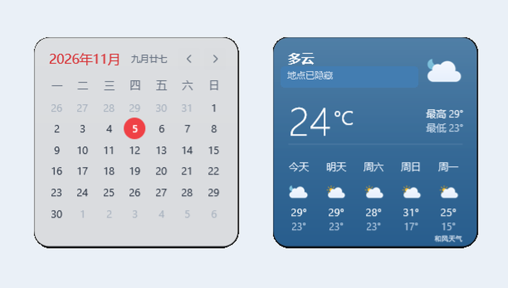

# 晴历 Qingli

简洁的 Rainmeter 桌面日历与天气小组件，让日期、农历和天气在桌面上一眼可见。

当前版本：**0.1.0-beta.2** · Windows / Rainmeter · 仓库名：`qingli-widgets`

目前提供源码安装，尚未发布安装包 Release。

## 预览



实际运行画面，已裁去桌面并遮盖地点栏。天气数值仅为截图当时的展示；图中使用可选的和风天气，首次安装默认使用无需个人 Key 的 Open-Meteo。

## 功能

| 功能 | 说明 |
| --- | --- |
| 月历与当天农历 | 固定六行月历、当天高亮、跨月日期淡显；支持前后翻月和返回本月。农历离线计算，翻月时仍显示当天农历。 |
| 当前天气与五日预报 | 显示天气状况、当前温度、最高 / 最低温及包含今天在内的五日预报，配有昼夜天气图标。 |
| 两种天气来源 | 默认 Open-Meteo，无需个人 Key；也可自行配置和风天气。 |
| 自动或手动位置 | 默认通过 IP 估计城市，也可指定城市名和经纬度。 |
| 配色与材质 | 提供经典红、湖蓝、青色、薄荷绿、紫色及自定义色相；支持“柔透 / 清晰”两种材质。 |
| 桌面布局 | 两张卡片可分别拖动；支持调整缩放、字体及每周起始日，配色和材质选择会保存到本地。 |

“柔透”使用半透明填充，不包含系统背景模糊。更多交互细节见 [功能说明](docs/FEATURES.md)。

## 安装

### 1. 安装 Rainmeter

从 [Rainmeter 官网](https://www.rainmeter.net/) 安装 Rainmeter。本项目基于 Rainmeter 4.5.28 整理，不附带 Rainmeter 程序、额外插件 DLL 或字体。

### 2. 下载并复制皮肤

点击本仓库 **Code → Download ZIP**，或[下载 main 分支源码 ZIP](https://github.com/gzhzk/qingli-widgets/archive/refs/heads/main.zip)，解压后将其中的 **`Qingli` 文件夹**复制到 Rainmeter 的皮肤目录。

普通安装的皮肤目录通常为“文档 / Rainmeter / Skins”；便携安装请使用对应的 `Skins` 目录。复制后应是以下结构，不要多套一层仓库文件夹：

```text
Skins/
└─ Qingli/
   ├─ @Resources/
   ├─ Start/
   │  └─ Start.ini
   └─ Widgets/
      ├─ Calendar/
      └─ Weather/
```

如果已有同名目录，请先按下方“升级与保留设置”操作。

### 3. 加载小组件

打开 **管理 Rainmeter**，点击“刷新全部”，找到并加载 **`Qingli → Start → Start.ini`**。

首次启动会创建缺失的个人配置，再显示并排列日历、天气两张卡片。之后可分别拖动卡片；若无法拖动，在 Rainmeter 的皮肤设置中启用“可拖动”。

默认会联网估计城市并获取天气。**若希望首次启动就使用手动位置**，请先按下一节创建 `Settings.inc`，设为 `LocationMode=Manual` 并填写城市及坐标，再加载 `Start.ini`。

## 使用与设置

- **日历**：使用左右箭头翻月，双击月份标题返回本月；右键菜单可更换配色、打开自定义色相面板。
- **天气**：点击天气文字、温度或大图标刷新；自动定位模式下，点击地点栏可重新定位并刷新。
- **材质与来源**：右键卡片可选择材质；天气右键菜单可切换天气来源。
- **位置**：分别拖动两张卡片，Rainmeter 会保存布局。

配置位于 `Qingli/@Resources/Refined/`。首次加载后编辑 `Settings.inc`；若尚未加载，可先将 `Settings.defaults.inc` 复制为同目录的 `Settings.inc`。修改后刷新相应皮肤。

| 设置项 | 默认值 | 用途 |
| --- | --- | --- |
| `Scale` | `0.9` | 调整卡片缩放。 |
| `WeekStartsMonday` | `1` | `1` 为周一开始，`0` 为周日开始。 |
| `FontFace` / `ChineseFont` | `Segoe UI` / `Microsoft YaHei UI` | 使用本机已安装的字体。 |
| `LocationMode` | `AutoIP` | 改为 `Manual` 后，填写 `ManualCity`、`ManualLatitude`、`ManualLongitude`。 |
| `WeatherProvider` | `OpenMeteo` | 可改为 `QWeather`，需另行配置个人凭据。 |

手动位置字段中的广州坐标是公开示例，使用前请替换成自己选择的城市；自动定位失败不会把该示例当作当前位置。

### 可选：和风天气

将 `QWeather.local.example.json` 复制为同目录的 `QWeather.local.json`，填写自己的 `apiHost` 和 `apiKey`，再选择 `QWeather`。详细步骤见 [和风天气配置](docs/QWEATHER.md)。

当前和风适配使用已有弃用提示的城市 v7 接口，尚未迁移，长期可用性需留意官方变化；默认 Open-Meteo 不依赖这些接口。天气来源切换需主动操作，请求失败时不会自动切换到另一提供方。

## 升级与保留设置

升级前备份 `Qingli` 文件夹及 Rainmeter 的布局，然后退出 Rainmeter。将新版源码中的 `Qingli` 文件夹合并到原目录，**不要先删除旧目录**。

请保留以下个人文件：

| 文件 | 保存内容 |
| --- | --- |
| `@Resources/Refined/Settings.inc` | 天气来源、位置、缩放、字体等设置。 |
| `@Resources/Refined/Accent.inc` | 配色。 |
| `@Resources/Refined/Material.inc` | 材质。 |
| `@Resources/Refined/QWeather.local.json` | 个人和风天气凭据（如有）。 |

仓库仅提供默认模板和空凭据示例，不携带上述个人文件；启动初始化也只补齐缺失配置。**不要用默认模板覆盖已有配置**。

重新启动 Rainmeter 后沿用原来的两张卡片；如需手动加载，分别加载：

```text
Qingli/Widgets/Calendar/Refined.ini
Qingli/Widgets/Weather/Refined.ini
```

**升级时不要再次加载 `Start.ini`**，它会主动重新排列两张卡片。卡片位置由当前 Rainmeter 实例保存，请同时保留原有 Rainmeter 配置。

## 网络与隐私

默认自动定位会访问 `ipwho.is`，天气请求发送到 Open-Meteo；选择和风天气后会使用对应服务。相关服务可接收请求 IP、查询坐标等信息。手动位置可以关闭 IP 城市查询，但仍需将所选坐标发送给天气提供方。

个人 Key 仅应保存在本地 `QWeather.local.json`。分享配置、日志或截图前，请检查凭据、地点和路径；不要把运行中的整个皮肤目录直接上传。更多说明见 [网络与隐私](docs/NETWORK-AND-PRIVACY.md)。

## 许可证与致谢

本项目基于 Creewick 的 [MontereyRainmeter](https://github.com/creewick/MontereyRainmeter) 整理与修改，保留原有许可证和上游署名。

- 皮肤及派生部分沿用 **CC BY-NC-SA 4.0**，包含非商业使用限制，详见 [LICENSE.txt](LICENSE.txt)。
- 天气图标来自 **Meteocons / Bas Milius**，定位图标来自 **Phosphor Icons**，分别保留 MIT 许可证。
- 完整来源、作者和第三方许可见 [ATTRIBUTION.md](ATTRIBUTION.md)。

“晴历 / Qingli”暂作为项目名称使用，商标可用性尚未完成核验。

## 源码与构建

使用 Python 3 运行以下命令，可在本地生成源码 ZIP、皮肤 ZIP 和校验文件：

```text
python tools/build.py --output dist
```

该命令不生成 `.rmskin`，也不会上传或发布安装包。开发与核验说明见 [维护说明](docs/MAINTAINING.md) 和 [验证记录](VALIDATION.md)。
